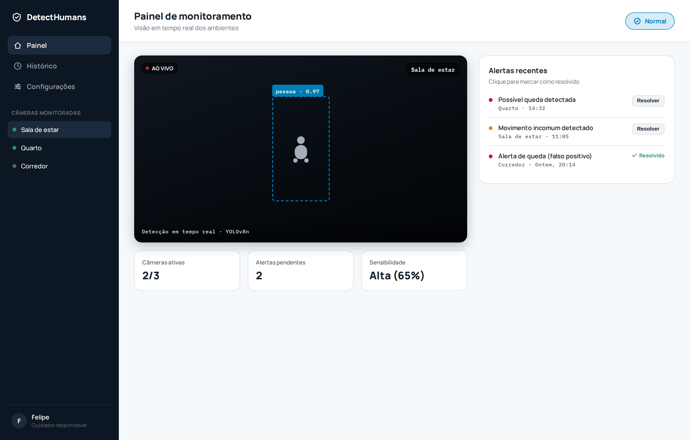
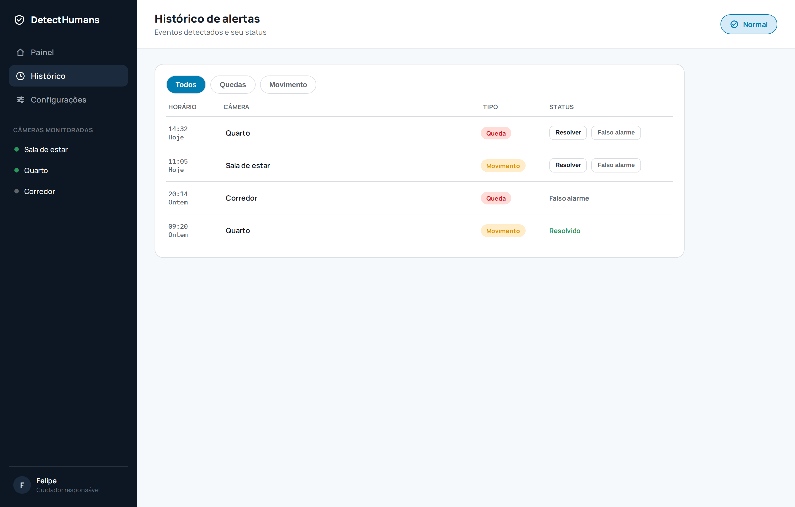
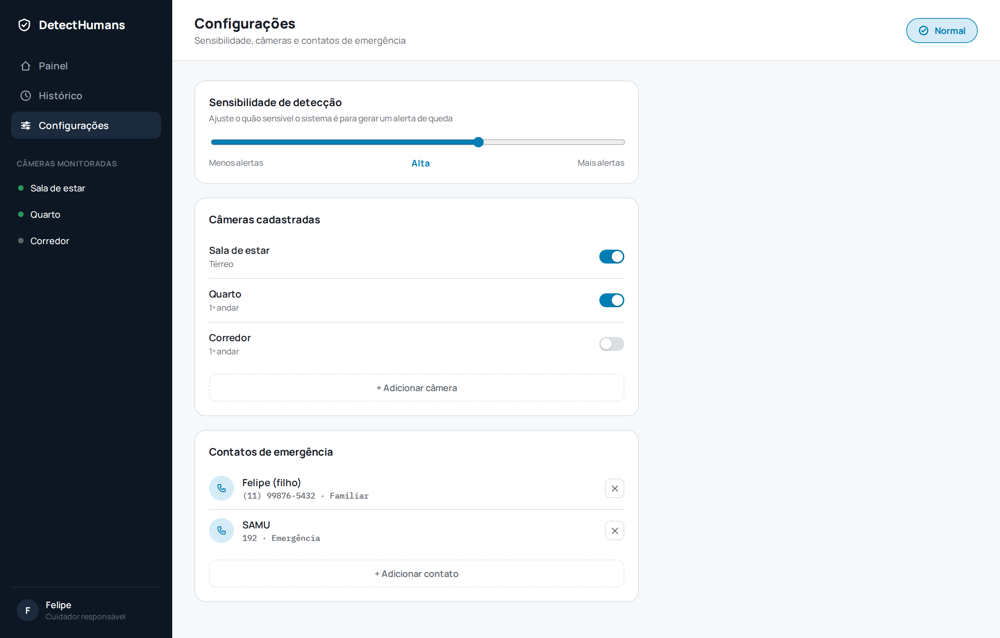
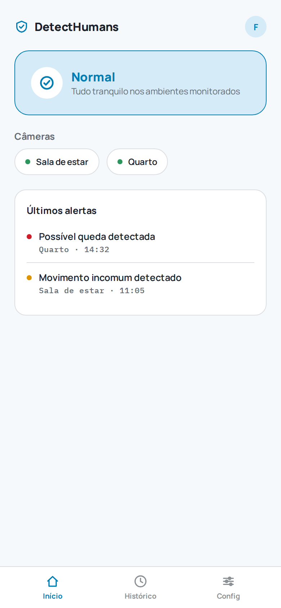
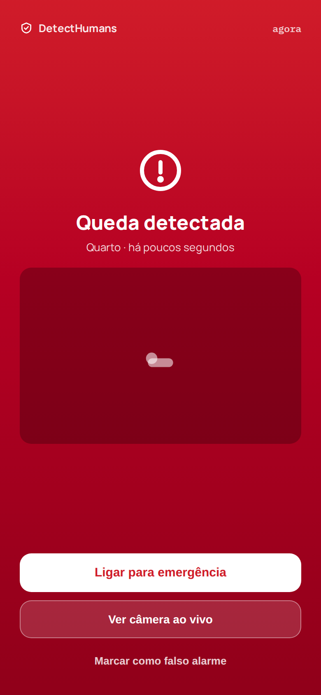

# DetectHumans - Projeto Integrador

Este repositorio faz parte de um **projeto integrador** com foco em Visao Computacional aplicada a seguranca e cuidado de pessoas.
Nesta etapa, o objetivo principal e **treinar um modelo YOLO (YOLOv8)** para detectar pessoas em imagens. Essa base sera utilizada em etapas futuras para construir funcionalidades de maior impacto, como:

- detectar quando um idoso caiu;
- identificar situacoes de risco ou acidentes;
- gerar alertas para apoio rapido.

## Objetivo do Projeto
Desenvolver um pipeline de deteccao de pessoas que sirva como fundacao para um sistema de monitoramento inteligente.

Neste momento, o projeto esta concentrado em:
- organizacao do dataset;
- treinamento supervisionado de deteccao;
- validacao inicial das metricas do modelo;
- salvamento de pesos para uso posterior em inferencia.

## Estrutura do Projeto
```text
detectHumans/
|- main.py
|- yolov8n.pt
|- dataset/
|  |- data.yaml
|  |- train.txt
|  |- images/
|  |  |- train/
|  |  |- val/
|  |- labels/
|     |- train/
|     |- val/
|- runs/
|  |- detect/
|     |- detect_human/
|        |- ex1/
|           |- args.yaml
|           |- results.csv
|           |- weights/
|              |- best.pt
|              |- last.pt
```

## Dataset
O dataset esta configurado em `dataset/data.yaml` com:

- `nc: 1` (uma classe);
- `names: ['pessoa']`;
- imagens de treino listadas em `dataset/train.txt`;
- conjunto de validacao em `dataset/images/val`.
As anotacoes estao no padrao YOLO (`.txt`) em `dataset/labels/`.

## Treinamento Atual
O treinamento esta implementado em `main.py` usando `ultralytics`:

- modelo base: `yolov8n.pt`;
- epocas: `100`;
- tamanho de imagem: `640`;
- batch: `8`;
- dispositivo: `cpu`;
- augmentacao habilitada.

Os resultados do experimento atual estao em `runs/detect/detect_human/ex1/`.
Exemplo de metrica observada ao final do treinamento (arquivo `results.csv`):

- `mAP50(B)` em torno de `0.995`;
- `mAP50-95(B)` em torno de `0.88`.
## Como Executar

1. Instale o Python (recomendado 3.10+).
2. Instale as dependencias:
```bash
pip install ultralytics
```
3. Execute o treinamento:

```bash
python main.py
```
Ao final, os pesos treinados serao salvos em:

- `runs/detect/detect_human/ex1/weights/best.pt`
- `runs/detect/detect_human/ex1/weights/last.pt`
## Prototipo PWA (Web/Mobile)
Como parte do Projeto Extensionista Integrador (PWAs com Frameworks Avancados), foi criado um prototipo navegavel da camada de interface que consumiria a deteccao feita pelo YOLOv8, cobrindo desktop e mobile.

**Prototipo interativo:** https://claude.ai/code/artifact/a8b1345c-c397-4796-80c3-3e5fced717e4

### Telas

| Painel (desktop) | Historico (desktop) | Configuracoes (desktop) |
|---|---|---|
|  |  |  |

| Painel (mobile) | Alerta de queda (mobile) |
|---|---|
|  |  |

## Proximas Etapas

- aumentar e balancear o dataset;
- melhorar robustez em diferentes ambientes (iluminacao, angulos, oclusao);
- criar logica temporal para diferenciar postura normal de queda;
- integrar alertas para cenarios reais de monitoramento de idosos.

## Observacoes
Este repositorio representa uma etapa importante de base tecnica. O foco futuro e transformar a deteccao de pessoas em uma solucao pratica para **prevencao e resposta a acidentes**, especialmente no contexto de cuidado com idosos.
